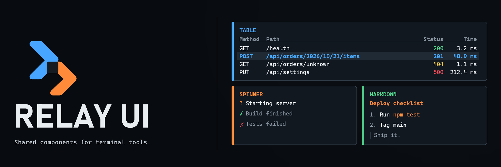

<p align="center">
  
</p>

Relay UI holds the terminal components that Relay's tools share: themes, spinners, tables, and Markdown. Each tool draws them the same way instead of keeping its own copy, and each component renders the same in a live terminal as in a single printed frame.

The components are ordinary Ink components. Ink and React are peer dependencies, so they render with the application's own copy of each.

## Try the demo

```sh
npm install
npm run demo
```

The gallery shows every component with sample data. Press `q` to quit. To print the gallery once, or to see it in the grey theme:

```sh
npx tsx src/cli.tsx --snapshot
npx tsx src/cli.tsx --theme mono
```

## Use the components

```sh
npm install @relay-cli/ui ink react
```

```tsx
import {render} from 'ink';
import {Markdown, Spinner, Table, ThemeProvider, resolveTheme} from '@relay-cli/ui';

const columns = [
  {key: 'method', header: 'Method'},
  {key: 'path', header: 'Path', truncate: 'middle' as const},
  {key: 'status', header: 'Status', align: 'right' as const},
];

render(
  <ThemeProvider theme={resolveTheme('relay')}>
    <Spinner label="Starting server" />
    <Table columns={columns} rows={requests} width={process.stdout.columns} />
    <Markdown source={reply} />
  </ThemeProvider>,
);
```

## Components

| Component       | What it draws                                                                                                  |
| --------------- | -------------------------------------------------------------------------------------------------------------- |
| `ThemeProvider` | Sets the colors every component below it uses. `relayTheme` and `monoTheme` are included.                      |
| `Spinner`       | An animated spinner with a label that turns into ✓ or ✗ when the work finishes.                                |
| `Table`         | Aligned columns that shrink to the terminal width, with middle truncation, a selected row, and scrolling.      |
| `Markdown`      | Headings, lists, quotes, code, pipe tables, and inline formatting, including replies that are still streaming. |

## Documentation

- [Package API](./docs/api.md)
- [Artwork](./docs/assets/ARTWORK.md)
- [Contributing](./CONTRIBUTING.md)

## Scope

Relay UI holds components that more than one Relay tool needs. Layout, focus, and keybindings belong to [Relay Shell](https://github.com/relay-cli/relay-shell); conversation and server-output interfaces stay in [Relay Chat](https://github.com/relay-cli/relay-chat) and [Relay Cards](https://github.com/relay-cli/relay-cards).

## Development

```sh
npm install
npm run check
```

`npm run check` verifies formatting, linting, strict types, tests, and the distributable package.

## License

MIT
